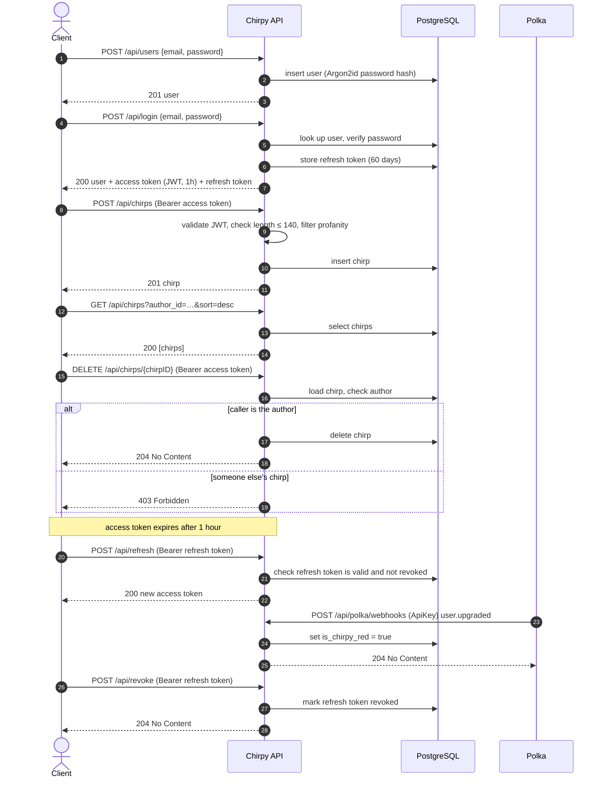

# Chirpy

*(this README.md is co-written by Claude Opus 5.5)*

This project was built as part of the guided [Learn HTTP Servers in Go](https://www.boot.dev/courses/learn-http-servers-golang) course on [boot.dev](https://www.boot.dev).

Chirpy is a small Twitter-like JSON API written in Go. Users can sign up, log in, and post short messages ("chirps") of up to 140 characters.


## features

Following the course, I built the APIs to support the following features:

- Users
  - sign up with email and password (passwords are hashed with Argon2id)
  - update your email and password
- Authentication
  - log in to get a JWT access token (1 hour) and a refresh token (60 days)
  - exchange a refresh token for a new access token
  - revoke a refresh token to log out
- Chirps
  - post a chirp of up to 140 characters (with profanity filtering)
  - list chirps (with optional filter by author ID and sort by creation time)
  - fetch a single chirp
  - delete your own chirps
- Chirpy Red membership
  - upgrade users to Chirpy Red through a Polka payment webhook (protected by an API key)
- Admin and operations
  - health check endpoint
  - serve static files from `public/` under `/app/`
  - view how many times `/app/` has been visited
  - reset the visit counter and delete all users (`dev` only)

## tech stack

- Go 1.26+
- PostgreSQL
- [goose](https://github.com/pressly/goose) for database migrations
- [sqlc](https://sqlc.dev/) (only if you change the SQL queries)

I tried add things with AI guidance after finishing the course:

- Docker (optional, to run the server as a container)

## how to run?

1. Clone the repository:

   ```sh
   git clone https://github.com/potpot1029/chirpy.git
   cd chirpy
   ```

2. Create a database:

   ```sh
   createdb chirpy
   ```

3. Copy the sample environment file and fill in your values:

   ```sh
   cp .env.example .env
   ```

   | Variable     | Description                                                        |
   | ------------ | ------------------------------------------------------------------ |
   | `DB_URL`     | PostgreSQL connection string                                       |
   | `PLATFORM`   | Set to `dev` to enable `POST /admin/reset`                         |
   | `JWT_SECRET` | Secret used to sign access tokens (e.g. `openssl rand -base64 64`) |
   | `POLKA_KEY`  | API key that Polka webhook requests must present                   |
   | `PORT`       | Port the server listens on (defaults to `8080`)                    |

4. Run the migrations:

   ```sh
   goose -dir sql/schema postgres "$DB_URL" up
   ```

5. Start the server:

   ```sh
   go run .
   ```

   The server listens on `http://localhost:8080` unless `PORT` is set.

### with Docker

Instead of step 5, you can build and run the server as a container. Steps 1–4 still apply: the image does not include PostgreSQL or run the migrations.

1. Build the image (requires [BuildKit](https://docs.docker.com/build/buildkit/), e.g. the `docker-buildx` package):

   ```sh
   docker build -t chirpy .
   ```

2. Run it with your `.env`:

   ```sh
   docker run --rm --network host --env-file .env chirpy
   ```

   - `--network host` (Linux) lets the container reach PostgreSQL on `localhost`. Without it, `localhost` in `DB_URL` refers to the container itself.
   - `docker run --env-file` does not strip quotes, so values in `.env` must be unquoted (as in `.env.example`).

The image is built on distroless and runs as a non-root user. `.env` is excluded from the build by `.dockerignore`, so secrets are only passed in at run time.

## API

All request and response bodies are JSON. Errors are returned as:

```json
{ "error": "description of the problem" }
```

Authenticated endpoints expect an `Authorization: Bearer <token>` header.

### flow

A typical client session, from sign-up to logout, plus the Polka upgrade webhook:



### health

| Method | Path           | Description                 |
| ------ | -------------- | --------------------------- |
| GET    | `/api/healthz` | Returns `200 OK` when ready |

### users

#### `POST /api/users`

Create a user.

```json
{ "email": "user@example.com", "password": "hunter2" }
```

Returns `201 Created`:

```json
{
  "id": "…",
  "created_at": "…",
  "updated_at": "…",
  "email": "user@example.com",
  "is_chirpy_red": false
}
```

#### `PUT /api/users`

Update the authenticated user's email and password. Requires an access token. Takes the same body as `POST /api/users` and returns the updated user.

### authentication

#### `POST /api/login`

```json
{ "email": "user@example.com", "password": "hunter2" }
```

Returns the user along with an access token (valid for 1 hour) and a refresh token (valid for 60 days):

```json
{
  "id": "…",
  "created_at": "…",
  "updated_at": "…",
  "email": "user@example.com",
  "is_chirpy_red": false,
  "token": "<jwt>",
  "refresh_token": "<refresh token>"
}
```

#### `POST /api/refresh`

Send the refresh token as `Authorization: Bearer <refresh token>`. Returns a new access token:

```json
{ "token": "<jwt>" }
```

#### `POST /api/revoke`

Send the refresh token as `Authorization: Bearer <refresh token>`. Revokes it and returns `204 No Content`.

### chirps

#### `POST /api/chirps`

Create a chirp. Requires an access token.

```json
{ "body": "Hello, world!" }
```

Chirps longer than 140 characters are rejected with `400 Bad Request`. The words `kerfuffle`, `sharbert`, and `fornax` are replaced with `****`. Returns `201 Created`:

```json
{
  "id": "…",
  "created_at": "…",
  "updated_at": "…",
  "body": "Hello, world!",
  "user_id": "…"
}
```

#### `GET /api/chirps`

List chirps, oldest first by default.

| Query parameter | Description                               |
| --------------- | ----------------------------------------- |
| `author_id`     | Only return chirps by this user ID        |
| `sort`          | `asc` (default) or `desc` by `created_at` |

#### `GET /api/chirps/{chirpID}`

Get a single chirp. Returns `404 Not Found` if it does not exist.

#### `DELETE /api/chirps/{chirpID}`

Delete a chirp. Requires an access token, and only the chirp's author may delete it (`403 Forbidden` otherwise). Returns `204 No Content`.

### webhooks

#### `POST /api/polka/webhooks`

Called by Polka when a payment event occurs. Requires `Authorization: ApiKey <POLKA_KEY>`.

```json
{
  "event": "user.upgraded",
  "data": { "user_id": "…" }
}
```

A `user.upgraded` event marks the user as Chirpy Red. Other events are ignored. Returns `204 No Content`.

### admin

| Method | Path             | Description                                                  |
| ------ | ---------------- | ------------------------------------------------------------ |
| GET    | `/admin/metrics` | HTML page showing how many times `/app/` has been visited    |
| POST   | `/admin/reset`   | Resets the hit counter and deletes all users (`dev` only)    |

### static files

`/app/` serves files from the `public/` directory (e.g. `public/index.html`, `public/assets/logo.png`). Every request increments the hit counter shown on `/admin/metrics`.

## development

Run the tests:

```sh
go test ./...
```

The API tests that need a database are skipped unless `TEST_DB_URL` is set. They delete all data in that database, so use a separate one:

```sh
createdb chirpy_test
goose -dir sql/schema postgres "postgres://<user>:<password>@localhost:5432/chirpy_test?sslmode=disable" up
TEST_DB_URL="postgres://<user>:<password>@localhost:5432/chirpy_test?sslmode=disable" go test ./...
```

Regenerate the database code after editing files in `sql/queries` or `sql/schema`:

```sh
sqlc generate
```